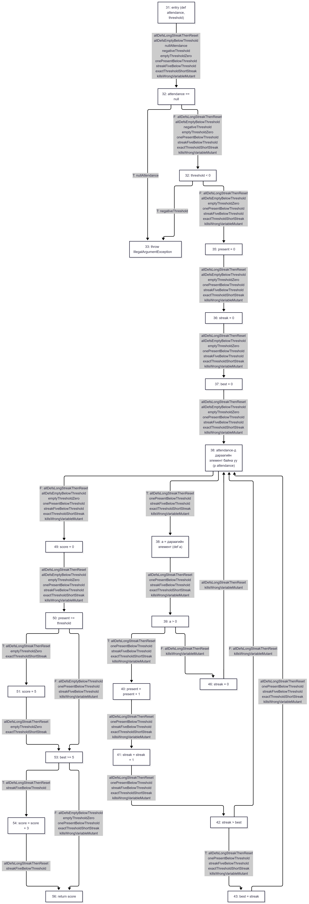

## Лаборатори 10

Гүйцэтгэсэн: Д.Гантогтох /B242270139/

DELL@DESKTOP-DJ67V87 MINGW64 /c/f.csa313/lab10-dataflow (main)
$ java -version
java version "25.0.2" 2026-01-20 LTS
Java(TM) SE Runtime Environment (build 25.0.2+10-LTS-69)
Java HotSpot(TM) 64-Bit Server VM (build 25.0.2+10-LTS-69, mixed mode, sharing)

DELL@DESKTOP-DJ67V87 MINGW64 /c/f.csa313/lab10-dataflow (main)
$ mvn -version
Apache Maven 3.9.12 (848fbb4bf2d427b72bdb2471c22fced7ebd9a7a1)
Maven home: C:\Program Files\apache-maven-3.9.12
Java version: 25.0.2, vendor: Oracle Corporation, runtime: C:\Program Files\Java\jdk-25.0.2
Default locale: en_US, platform encoding: UTF-8
OS name: "windows 11", version: "10.0", arch: "amd64", family: "windows"

## A: gcd DU анализ

### Def/Use (файлын мөрөөр)
| Мөр | Код | Def | Use |
|---|---|---|---|
| 13 | gcd(int x, int y) | x, y | |
| 15 | while (y != 0) | | y (p) |
| 16 | tmp = x % y; | tmp | x, y (c) |
| 17 | x = y; | x | y (c) |
| 18 | y = tmp; | y | tmp (c) |
| 20 | return x; | | x (c) |

Мөр 14 (`int tmp;`) зөвхөн зарлалт, def биш.

### DU хосууд
| # | Хувьсагч | Def | Use | Төрөл | Def-clear зам | Тестийн ID | Хамрагдсан |
|---|---|---|---|---|---|---|---|
| 1 | x | 13 | 16 | c | 13→15→16 | gcdTwoIterations | Тийм |
| 2 | x | 13 | 20 | c | 13→15→20 | gcdZeroY | Тийм |
| 3 | x | 17 | 16 | c | 17→18→15→16 | gcdTwoIterations | Тийм |
| 4 | x | 17 | 20 | c | 17→18→15→20 | gcdTwoIterations | Тийм |
| 5 | y | 13 | 15 | p (T) | 13→15 | gcdTwoIterations | Тийм |
| 6 | y | 13 | 15 | p (F) | 13→15 | gcdZeroY | Тийм |
| 7 | y | 13 | 16 | c | 13→15→16 | gcdTwoIterations | Тийм |
| 8 | y | 13 | 17 | c | 13→15→16→17 | gcdTwoIterations | Тийм |
| 9 | y | 18 | 15 | p (T) | 18→15 | gcdTwoIterations | Тийм |
| 10 | y | 18 | 15 | p (F) | 18→15 | gcdTwoIterations | Тийм |
| 11 | y | 18 | 16 | c | 18→15→16 | gcdTwoIterations | Тийм |
| 12 | y | 18 | 17 | c | 18→15→16→17 | gcdTwoIterations | Тийм |
| 13 | tmp | 16 | 18 | c | 16→17→18 | gcdTwoIterations | Тийм |

Нийт 11 хос (p-use-ийн T/F-ийг тусад нь тоовол 13).

### Тестүүд
- `gcdZeroY`: gcd(7,0). Давталтад орохгүй, мөр 15 шууд false. Ганцаараа (x,13,20) ба (y,13,15F)-ийг хамарна.
- `gcdTwoIterations`: gcd(12,8). Давталт 2 удаа (12,8 → 8,4 → 4,0), мөр 15 нийт 3 удаа шалгагдана. Давталтын def-ээс use хүрэх хосууд (x,17,16), (y,18,16) зэрэг 2-р давталтад л хамрагдана.

## B: bonus() бүрэн анализ

### B1: CFG

Зангилаа бүр файлын мөрийн дугаартай. For-each (мөр 38) нь нөхцөл (attendance-д дараагийн элемент байна уу, attendance-ийн p-use) ба алхам (a-д дараагийн элементийг оноох, a-ийн def) гэсэн хоёр зангилаа. Ирмэг бүрийн хажууд түүнийг дайрдаг тестийн бодит метод нэрийг бичсэн (T/F нь салааны чиглэл).

| Тестийн ID | Метод | Оролт | Үр дүн |
|---|---|---|---|
| ALLDEFS-1 | allDefsLongStreakThenReset | [1,1,1,1,1,0,1], thr 3 | 8 |
| ALLDEFS-2 | allDefsEmptyBelowThreshold | [], thr 1 | 0 |
| DU-3 | nullAttendance | null, thr 1 | IllegalArgumentException |
| DU-4 | negativeThreshold | [1], thr -1 | IllegalArgumentException |
| DU-5 | emptyThresholdZero | [], thr 0 | 5 |
| DU-6 | onePresentBelowThreshold | [1], thr 2 | 0 |
| DU-7 | streakFiveBelowThreshold | [1,1,1,1,1], thr 6 | 3 |
| DU-8 | exactThresholdShortStreak | [1], thr 1 | 5 |
| M2-KILL | killsWrongVariableMutant | [1,1,0,1,1,1], thr 6 | 0 |

### B2: Def/Use жагсаалт (файлын мөр)

| Мөр | Код | Def | c-use | p-use |
|---|---|---|---|---|
| 31 | bonus(int[] attendance, int threshold) | attendance, threshold | | |
| 32 | if (attendance == null \|\| threshold < 0) | | | attendance, threshold |
| 33 | throw new IllegalArgumentException | | | |
| 35 | int present = 0; | present | | |
| 36 | int streak = 0; | streak | | |
| 37 | int best = 0; | best | | |
| 38 | for (int a : attendance) | a | | attendance |
| 39 | if (a > 0) | | | a |
| 40 | present = present + 1; | present | present | |
| 41 | streak = streak + 1; | streak | streak | |
| 42 | if (streak > best) | | | streak, best |
| 43 | best = streak; | best | streak | |
| 46 | streak = 0; | streak | | |
| 49 | int score = 0; | score | | |
| 50 | if (present >= threshold) | | | present, threshold |
| 51 | score = 5; | score | | |
| 53 | if (best >= 5) | | | best |
| 54 | score = score + 3; | score | score | |
| 56 | return score; | | score | |

Мөр 32 дээр `||` богино залгаастай: attendance null бол threshold шалгагдахгүй. Тиймээс threshold-ийн p-use нь attendance != null үед л хүрнэ.

### B3: DU хүснэгт

Kill (def-ийг алдах):
- Мөр 41 (`streak = streak + 1`) нь өмнөх streak-ийн def 36, 46-г алдана.
- Мөр 46 (`streak = 0`) нь def 36, 41-ийг алдана.
- Мөр 42, 43-т хүрэх бүх зам мөр 41-ээр дамждаг. Тиймээс def 36 болон 46-аас 42, 43 хүрэх def-clear зам байхгүй. Эдгээр 4 хослол DU хос биш: (streak,36,42), (streak,36,43), (streak,46,42), (streak,46,43).
- (streak,41,41): 41→42→(43)→38→39T→40→41 замд streak дахин тодорхойлогдохгүй тул def-clear, хос мөн. Харин 39F салаагаар мөр 46-д орвол def 41 алдагдана (kill), тэр зам нь DU хос үүсгэхгүй.

| # | Хувьсагч | Def | Use | Төрөл | Def-clear зам | Тестийн ID | Хамрагдсан |
|---|---|---|---|---|---|---|---|
| 1 | attendance | 31 | 32T | p | 31→32 | DU-3 | Тийм |
| 2 | attendance | 31 | 32F | p | 31→32 | ALLDEFS-1 | Тийм |
| 3 | attendance | 31 | 38T | p | 31→32→35→36→37→38 | ALLDEFS-1 | Тийм |
| 4 | attendance | 31 | 38F | p | 31→32→35→36→37→38 | ALLDEFS-2 | Тийм |
| 5 | threshold | 31 | 32T | p | 31→32 | DU-4 | Тийм |
| 6 | threshold | 31 | 32F | p | 31→32 | ALLDEFS-1 | Тийм |
| 7 | threshold | 31 | 50T | p | 31→32→35→36→37→38→49→50 | ALLDEFS-1 | Тийм |
| 8 | threshold | 31 | 50F | p | 31→32→35→36→37→38→49→50 | ALLDEFS-2 | Тийм |
| 9 | a | 38 | 39T | p | 38→39 | ALLDEFS-1 | Тийм |
| 10 | a | 38 | 39F | p | 38→39 | ALLDEFS-1 | Тийм |
| 11 | present | 35 | 40 | c | 35→36→37→38→39→40 | ALLDEFS-1 | Тийм |
| 12 | present | 40 | 40 | c | 40→41→42→43→38→39→40 | ALLDEFS-1 | Тийм |
| 13 | present | 35 | 50T | p | 35→36→37→38→49→50 | DU-5 | Тийм |
| 14 | present | 35 | 50F | p | 35→36→37→38→49→50 | ALLDEFS-2 | Тийм |
| 15 | present | 40 | 50T | p | 40→41→42→38→49→50 | ALLDEFS-1 | Тийм |
| 16 | present | 40 | 50F | p | 40→41→42→38→49→50 | DU-6 | Тийм |
| 17 | streak | 36 | 41 | c | 36→37→38→39→40→41 | ALLDEFS-1 | Тийм |
| 18 | streak | 41 | 41 | c | 41→42→43→38→39→40→41 | ALLDEFS-1 | Тийм |
| 19 | streak | 46 | 41 | c | 46→38→39→40→41 | ALLDEFS-1 | Тийм |
| 20 | streak | 41 | 42T | p | 41→42 | ALLDEFS-1 | Тийм |
| 21 | streak | 41 | 42F | p | 41→42 | ALLDEFS-1 | Тийм |
| 22 | streak | 41 | 43 | c | 41→42→43 | ALLDEFS-1 | Тийм |
| 23 | best | 37 | 42T | p | 37→38→39→40→41→42 | ALLDEFS-1 | Тийм |
| 24 | best | 37 | 42F | p | (биелэшгүй) | - | Биелэшгүй |
| 25 | best | 37 | 53T | p | (биелэшгүй) | - | Биелэшгүй |
| 26 | best | 37 | 53F | p | 37→38→49→50→53 | ALLDEFS-2, DU-5 | Тийм |
| 27 | best | 43 | 42T | p | 43→38→39→40→41→42 | ALLDEFS-1 | Тийм |
| 28 | best | 43 | 42F | p | 43→38→39→40→41→42 | ALLDEFS-1 | Тийм |
| 29 | best | 43 | 53T | p | 43→38→49→50→53 | ALLDEFS-1 | Тийм |
| 30 | best | 43 | 53F | p | 43→38→49→50→53 | DU-6 | Тийм |
| 31 | score | 49 | 54 | c | 49→50→53→54 | DU-7 | Тийм |
| 32 | score | 49 | 56 | c | 49→50→53→56 | ALLDEFS-2 | Тийм |
| 33 | score | 51 | 54 | c | 51→53→54 | ALLDEFS-1 | Тийм |
| 34 | score | 51 | 56 | c | 51→53→56 | DU-8 | Тийм |
| 35 | score | 54 | 56 | c | 54→56 | ALLDEFS-1 | Тийм |

Нийт 35 хос (p-use-ийн T/F салааг тусад нь тоосон), үүнээс 2 нь биелэшгүй, 33 хос биелэгдэх ёстой бөгөөд бүгд хамрагдсан.

Биелэшгүй хосын үндэслэл:
- (best,37,42F): best нь 37-ийн утга 0 байх үед мөр 42 дээр streak нь дөнгөж 41-д нэмэгдсэн тул streak >= 1 > 0. Нөхцөл үргэлж true.
- (best,37,53T): best нь 37-ийн утга 0 хэвээр үед `0 >= 5` үргэлж false.

### B4: All-defs (хамгийн цөөн тест) ба all-DU-pairs

**All-defs: 2 тест (ALLDEFS-1, ALLDEFS-2).** 1 тест хүрэхгүй, учир нь score-ийн def 49 use-д хүрэхийн тулд мөр 50 false байх ёстой (true бол мөр 51 түүнийг дарна). Харин def 51 нь мөр 50 true үед л гүйцэтгэгдэнэ. Нэг гүйцэтгэлд мөр 50 нэгэн зэрэг true ба false байж болохгүй тул хамгийн багадаа 2 тест хэрэгтэй. ALLDEFS-1 (50T, 53T) нь def 51, 54-ийг, ALLDEFS-2 (50F, 53F) нь def 49-ийг use-д хүргэнэ. Бусад хувьсагчийн бүх def мөн хоёр тестээр use-д хүрнэ, ялангуяа ALLDEFS-1-ийн тасалсан өдрийн (0) дараах 1 нь def 46-г мөр 41-д хүргэнэ.

Дараа нь all-DU-pairs хүртэл DU-3...DU-8 гэсэн 6 тест нэмсэн (тусдаа commit). Нийт bonus 8 тест, M2-KILL нь C хэсгийн дараа нэмэгдсэн 9 дэх тест.

### B5: JaCoCo

| Үе шат | Тест | BRANCH missed/covered | LINE missed/covered | Эх сурвалж |
|---|---|---|---|---|
| all-defs | 4 (gcd 2 + bonus 2) | 2 / 14 | 2 / 23 | results/jacoco-alldefs.csv |
| эцсийн | 11 (gcd 2 + bonus 9) | 0 / 16 | 1 / 24 | results/jacoco-final.csv |

LINE_MISSED = 1 нь мөр 7 (далд constructor).

all-defs шатанд мөр 32-ын `attendance == null` ба `threshold < 0` гэсэн 2 true салаа
хамрагдаагүй (хамрагдаагүй мөр: 7 далд constructor, 33 `throw`). Ямар ч def-use хос
exception-ы замыг шаарддаггүй тул all-defs хангагдсан ч branch 100% болоогүй.

### B6: Branch ба DU хамралтын ажиглалт

**All-defs хангагдсан ч branch 100% биш.** `jacoco-alldefs.csv`-д Branch 2 missed / 14 covered байсан. Хамрагдаагүй нь мөр 32-ын 2 true салаа (null, threshold < 0). Ямар ч def-use хос exception-ы замыг шаарддаггүй тул all-defs тэдгээрийг шаардаагүй.

**Branch 100% болсон ч DU хос үлдэж болно.** Жишээ нь gcd-ийн 2 тест + ALLDEFS-1, ALLDEFS-2, DU-3, DU-4 гэсэн bonus-ийн 4 тест. Гараар тоолоход бүх 16 салаа хамрагдана (мөр 32 дээр DU-3, DU-4 нь true салаануудыг, ALLDEFS-1 нь 50T, 53T, 42T/F, 39T/F-ийг, ALLDEFS-2 нь 50F, 53F-ийг нэмнэ). Гэтэл дараах хос хамрагдаагүй хэвээр:
- (score,49,54): 50F дараа нь 53T хэрэгтэй, гэтэл ALLDEFS-1 нь 50T, 53T, ALLDEFS-2 нь 50F, 53F.
- (score,51,56): 50T дараа нь 53F хэрэгтэй, тийм тест байхгүй.
- (present,35,50T): present = 0 байхад threshold <= 0 хэрэгтэй, ALLDEFS-2-ийн threshold 1.
- (present,40,50F): present >= 1 бөгөөд threshold-оос бага хэрэгтэй, тийм тест байхгүй.
- (best,43,53F): 1 <= best < 5 хэрэгтэй, тийм тест байхгүй.

Мөр 50, 53 бүр true/false хоёр талаараа хамрагдсан ч тэдгээрийн хослол хамрагдаагүй. Branch хамрал салаа бүрийг тусад нь, DU хамрал def ба use-ийн хослолыг шалгадаг. Үүнийг JaCoCo хэмжихгүй. Энэ тайлбар нь гараар хийсэн шинжилгээ, `results/`-ийн файл биш.

## C: Fault seeding

| № | Мутаци | Унасан тест | expected / was | Үр дүн | Файл |
|---|---|---|---|---|---|
| M1 | мөр 41 устгасан | allDefsLongStreakThenReset:14 | expected: <8> but was: <5> | Баригдсан | mvn-test-M1.txt |
| M1 | | streakFiveBelowThreshold:50 | expected: <3> but was: <0> | Баригдсан | mvn-test-M1.txt |
| M2 | мөр 43 `best = present;` | (10 тестийн аль нь ч унасангүй) | - | АМЬД | mvn-test-M2.txt |
| M2 | нэмсэн killsWrongVariableMutant | killsWrongVariableMutant:62 | expected: <0> but was: <3> | Баригдсан | mvn-test-M2-kill.txt |
| M3 | `int total = present + best;` | байхгүй | - | АМЬД | mvn-test-M3.txt |

### M1: missing update

Мөр 41 (`streak = streak + 1`) устгахад streak үргэлж 0 хэвээр, мөр 42-ийн `streak > best` үргэлж false болж best = 0 хэвээр үлдэнэ. Тиймээс 5-аас урт цуваатай оролтод +3 оноо алга болно. ALLDEFS-1 (expected 8, was 5) ба DU-7 (expected 3, was 0) унасан нь (streak,41,42), (streak,41,43) хосыг шалгасан тестүүд баригдсан гэсэн үг.

### M2: wrong variable (амьд үлдсэн)

Миний бичсэн 10 тест (all-DU-pairs, нэмэлт M2-KILL тестээс өмнө) M2-ийг барьсангүй (`mvn-test-M2.txt`: Tests run: 10, Failures: 0). Шалтгаан: best шинэчлэгдэх мөчид (мөр 43) present ба streak үргэлж тэнцүү байсан. Бүх тестэд best нь эхний тасалдалгүй цуваанд шинэчлэгдэх тул present = streak (1, 2, ..., 5), `best = streak` ба `best = present` ялгагдахгүй. (best,43,...) хосууд хамрагдсан ч хосыг хамарсан нь зөв хувьсагчийг шалгасан гэсэн үг биш.

Унагах тест: `killsWrongVariableMutant`: `[1,1,0,1,1,1]`, threshold 6, хүлээгдэх үр дүн 0. Анхны кодод best = 3 (<5), present = 5 < 6 тул оноо 0. M2-д сүүлийн ирсэн өдөр present = 5, streak = 3 болж ялгагдан best = 5 болж +3 оноо өгнө. Үр дүн: expected: <0> but was: <3> (`mvn-test-M2-kill.txt`). Тестийг нэмсний дараа эх кодод бүх 11 тест ногоон.

### M3: dead definition

`int total = present + best;` нь def-тэй боловч use-гүй. Тиймээс DU хос үүсэхгүй ба `bonus()`-ийн буцаах утгад нөлөөлөхгүй тул ямар ч assert унахгүй (`mvn-test-M3.txt`: Tests run: 11, Failures: 0). javac хэрэглэгдээгүй local хувьсагчийн талаар анхдагчаар анхааруулдаггүй (Java хэлний алдаа биш).

IDE (VS Code Java Language Server, Problems таб) анхааруулга:

`The value of the local variable total is not used  Java(536870973)  [Ln 49, Col 13]`

Энэ төрлийн data-flow аномалийг (def-ийн дараа use байхгүй) static analysis багаж (IDE, SpotBugs, PMD, Checkstyle) барина, тест барихгүй.

## Дүгнэлт

DU анализ нь branch хамралтаас илүү, учир нь салаа бүрийг тусад нь биш, хувьсагчийн утга хаана тодорхойлогдож хаана хэрэглэгдэхийг шалгадаг. B5-д үзүүлсэнчлэн branch 100% болсон ч (score,49,54) зэрэг 5 хос хамрагдаагүй үлдэж болно. Харин үнэтэй талаараа CFG зурах, def-clear зам олох, kill-ийг ялгах, биелэшгүй хосыг үндэслэх зэргийг гараар хийх ёстой, bonus() дээр 35 хос гарсан бөгөөд JaCoCo үүнийг хэмжихгүй. Мөн DU хамрал нь утга шалгадаггүй: M2 нь бүх хос хамрагдсан тестүүдийг давж амьд үлдэж, present ≠ streak болох тусгай оролтоор л баригдсан. M1 нь (streak,41,42) хосыг шалгасан тестүүдэд шууд баригдсан. M3 (dead definition) нь use-гүй тул DU хос үүсгэдэггүй, зөвхөн static analysis барьсан. Иймд DU хамралыг утгын шалгалт, mutation testing ба static analysis-тай хамт хэрэглэх нь зүйтэй. Хамгийн их цаг авсан алхам нь B3 (DU хүснэгт, kill ба def-clear замыг гараар шалгах хэсэг) байсан.

## AI ашигласан тухай

AI туслах (Claude) ашигласан: (1) DU анализын ойлголт тайлбарлуулах, (2) def/use жагсаалт, DU хүснэгт, тестийн ноорог гаргуулах, (3) Windows/git/Maven (JaCoCo-г Java 25-д зориулж шинэчлэх) алдаа засах, (4) README-ийн бүтэц болон CFG-ийн Mermaid эх бичих.